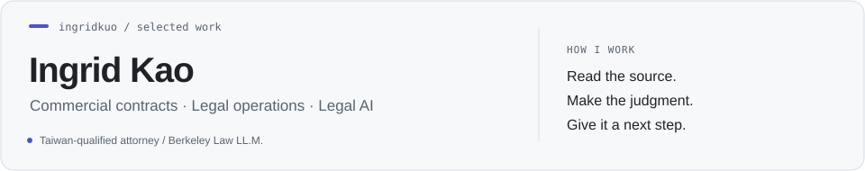

<picture>
  <source media="(prefers-color-scheme: dark)" srcset="assets/header-dark.svg">
  
</picture>

# Ingrid Kao

**Taiwan-qualified attorney · UC Berkeley Law, LL.M. (2026)**

I work on commercial agreements, contract workflows and legal review rules. At Lawsnote, I translated an enterprise client's NDA standards into rules engineers built into an AI contract-review product. As sole in-house counsel, I built a contract filing and approval process and followed agreements through acceptance and payment.

[Portfolio](https://ingridkao.netlify.app/) · [LinkedIn](https://www.linkedin.com/in/ingrid-kao-1702aa26b/) · [Email](mailto:kuoingrid0118@gmail.com)

## Selected work

### [Legal AI review](work/legal-ai-review.md)

A local browser/Python prototype, evaluation harness and SALI crosswalk. Inspect the three-batch results, exact-source checks and the handling of embedded instructions and missing sources.

### [Contract operations and data quality](work/contract-operations.md)

Intake and approval routing, an obligation tracker, and independent XML-to-JSON reconciliation. The examples keep missing facts, exceptions and the next owner visible.

### [Commercial contract judgment](work/commercial-contracts.md)

A signed technology license, a raised liability cap, and equipment acceptance linked to payment and remedies.

[Read the six-page Work Samples](docs/Ingrid_Kao_Work_Samples.pdf)

The working examples use Python, SQLite, JavaScript, Excel and XML/JSON. My platform experience includes DocuSign CLM and Ironclad test workflows.

Outside work: hiking, piano and calligraphy.
